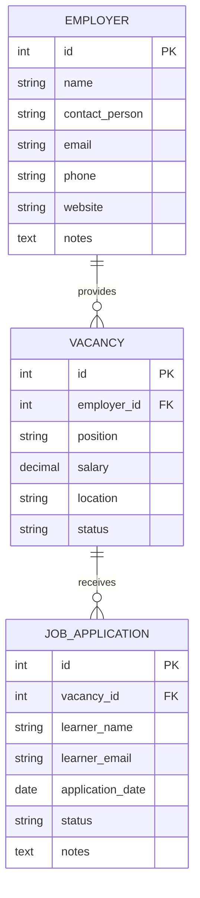

# Database Relationship Diagram

## 1. Introduction

This document explains the database structure and relationships used in the Job & Employability Progression Management System.

The system uses three main database models:

1. Employer
2. Vacancy
3. JobApplication

These models are connected using foreign keys to organise information and reduce unnecessary duplication.

The Django application uses Django ORM models, while the FastAPI application uses SQLAlchemy models to access the same database tables.

## 2. Entity Relationship Diagram

The following diagram shows the relationships between the three main entities.

## 3. Explanation of Relationships

### Employer to Vacancy

**Relationship:** One-to-Many (1:M)

One employer can provide multiple job vacancies.

For example:

- ABC Technologies can advertise a Software Developer vacancy.
- ABC Technologies can also advertise a Cybersecurity Analyst vacancy.
- Both vacancies belong to the same employer.

The `Vacancy` model contains a foreign key called `employer` in Django and `employer_id` in SQLAlchemy.

This foreign key connects each vacancy to its employer.

### Vacancy to JobApplication

**Relationship:** One-to-Many (1:M)

One vacancy can receive multiple job applications from different learners.

For example:

- A Software Developer vacancy may receive applications from Sam, Alice and John.
- Each application belongs to that particular vacancy.

The `JobApplication` model contains a foreign key called `vacancy` in Django and `vacancy_id` in SQLAlchemy.

This foreign key connects each application to its vacancy.

## 4. Database Tables

### Employer Table

| Field | Data type | Description |
|---|---|---|
| id | Integer | Primary key and unique employer ID. |
| name | CharField(100) | Employer name. |
| contact_person | CharField(100) | Contact person's name. |
| email | EmailField | Employer email address. |
| phone | CharField(100) | Employer telephone number. |
| website | URLField | Employer website. |
| notes | TextField | Additional employer information. |

**Primary key:** `id`

### Vacancy Table

| Field | Data type | Description |
|---|---|---|
| id | Integer | Primary key and unique vacancy ID. |
| employer | ForeignKey | References the Employer table. |
| position | CharField(100) | Job title or position. |
| salary | DecimalField(10,2) | Vacancy salary. |
| location | CharField(100) | Job location. |
| status | CharField(15) | Open or Closed. |

**Primary key:** `id`  
**Foreign key:** `employer`

### JobApplication Table

| Field | Data type | Description |
|---|---|---|
| id | Integer | Primary key and unique application ID. |
| learner_name | CharField(100) | Learner's full name. |
| learner_email | EmailField | Learner's email address. |
| vacancy | ForeignKey | References the Vacancy table. |
| application_date | DateField | Date of application. |
| status | CharField(20) | Current application status. |
| notes | TextField | Additional application information. |

**Primary key:** `id`  
**Foreign key:** `vacancy`

## 5. Primary Keys and Foreign Keys

### Primary Keys

A primary key uniquely identifies each record in a database table.

For example:

- Employer ID identifies an employer.
- Vacancy ID identifies a vacancy.
- JobApplication ID identifies an application.

Each table has its own primary key called `id`.

### Foreign Keys

A foreign key links one database table to another.

In this project:

- `Vacancy.employer` references `Employer.id`.
- `JobApplication.vacancy` references `Vacancy.id`.

Foreign keys help maintain referential integrity by ensuring that related records reference existing records.

## 6. Referential Integrity and Deletion Rules

The project uses `on_delete=models.PROTECT` for its Django foreign key relationships.

This means:

- An employer cannot be deleted while vacancies are linked to it.
- A vacancy cannot be deleted while job applications are linked to it.

The API implements equivalent checks before deleting these records.

This protects important information and prevents dependent records from being left without their related employer or vacancy.

## 7. Example Data

The following example demonstrates how the relationships work.

### Employer

| id | name |
|---|---|
| 1 | ABC Technologies |

### Vacancy

| id | employer_id | position | salary | status |
|---|---|---|---|---|
| 1 | 1 | Software Developer | 30000.00 | Open |
| 2 | 1 | Cybersecurity Analyst | 28000.00 | Open |

Both vacancies reference Employer ID 1.

### JobApplication

| id | vacancy_id | learner_name | status |
|---|---|---|---|
| 1 | 1 | Sam Taylor | Applied |
| 2 | 1 | Alice Brown | Interview |
| 3 | 2 | John Smith | Draft |

Applications 1 and 2 belong to the Software Developer vacancy. Application 3 belongs to the Cybersecurity Analyst vacancy.

## 8. Relationship Summary

| Parent entity | Child entity | Relationship | Foreign key |
|---|---|---|---|
| Employer | Vacancy | One-to-Many | Vacancy.employer |
| Vacancy | JobApplication | One-to-Many | JobApplication.vacancy |

## 9. Database Design Benefits

The relational database design provides several benefits:

- **Reduced duplication:** Employer information is stored once and referenced by vacancies.
- **Data consistency:** Foreign keys link related records.
- **Easier searching:** Related information can be retrieved through database relationships.
- **Data protection:** Protected relationships prevent deletion of records that still have dependent information.
- **Maintainability:** Each model has a clear responsibility.

## 10. Conclusion

The database design provides a structured way to manage employers, vacancies and learner job applications.

The one-to-many relationships allow one employer to provide several vacancies and one vacancy to receive multiple applications.

This design supports the main functionality of the Job & Employability Progression Management System and allows both Django and FastAPI to work with the same database structure.